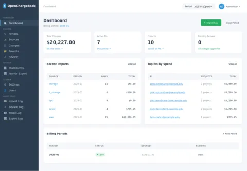
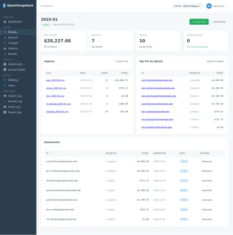
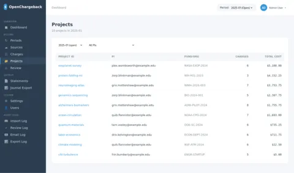
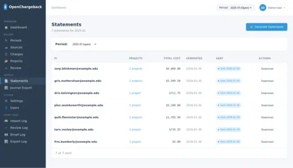
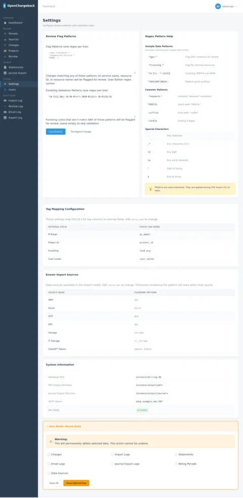

# OpenChargeback

**Simple, transparent billing for research computing.**

OpenChargeback helps research computing groups show PIs exactly what their cloud, HPC, and storage resources cost—even when those costs are partially or fully subsidized.

It's a correction layer, not a billing system.  The cloud bill knows what was spent, not who should pay.  OpenChargeback imports FOCUS-format usage, lands each charge on the right PI and fund/org, and produces PI statements plus a balanced, hash-verifiable close package for accounting.  It never moves money.

It's built for the one person tracking 40 PIs' research-infrastructure spend in spreadsheets.

## Status

Version 0.4.1, under active development.

**Working today:** FOCUS import from the CLI or web UI, charge review, statement PDFs and email, GL journal exports, the two-stage period close (close, then finalize), the deterministic close package, and admin/reviewer/viewer roles.  CI re-proves the close package's byte-determinism on every push.

**Not there yet:**
- SQLite is the only supported database.  `db/engine.py` will accept a Postgres URL, but that path is untested.
- Real exports have been imported at one site, but this repo holds no record of a production month-end with accounting on the receiving end.  Plan your own parallel run first.  The [deployment planning guide](docs/getting-started/deployment-planning.md) lists the decisions your institution has to make.

## The Problem

You run research computing infrastructure—shared HPC, cloud allocations, campus storage. Your PIs use these resources, and someone needs to track usage for grant reporting, chargebacks, or just so researchers understand the true cost of what they're consuming.

Enterprise FinOps tools exist, but they're designed for organizations spending millions per month with dedicated billing teams. You don't need a $50k/year platform. You need something that imports billing data, shows PIs their costs with discount transparency, generates PDF statements, and exports journal entries—without requiring a DBA or enterprise contract.

## How It Works

```
┌─────────────┐     ┌─────────────┐     ┌─────────────┐     ┌─────────────┐
│  AWS/Azure  │     │    HPC      │     │   Storage   │     │   Other     │
│   Export    │     │   Slurm     │     │   Reports   │     │   Sources   │
└──────┬──────┘     └──────┬──────┘     └──────┬──────┘     └──────┬──────┘
       │                   │                   │                   │
       └───────────────────┴───────────────────┴───────────────────┘
                                   │
                                   ▼
                         ┌─────────────────┐
                         │   FOCUS CSV     │
                         │   (Standard     │
                         │    Format)      │
                         └────────┬────────┘
                                  │
                                  ▼
                         ┌─────────────────┐
                         │ OpenChargeback  │
                         │  CLI or Web UI  │
                         └────────┬────────┘
                                  │
                   ┌──────────────┼──────────────┐
                   ▼              ▼              ▼
             ┌──────────┐  ┌──────────┐  ┌──────────┐
             │   PDF    │  │  Email   │  │ Journal, │
             │Statements│  │ Delivery │  │Close Pkg │
             └──────────┘  └──────────┘  └──────────┘
```

## Screenshots

[](docs/images/Dashboard-OpenChargeback.webp)
[](docs/images/Period-2025-01-OpenChargeback.webp)
[](docs/images/Projects-OpenChargeback.webp)
[](docs/images/Statements-OpenChargeback.webp)
[](docs/images/Settings-OpenChargeback.webp)

## Features

- **Multi-source billing** — Combine anything that exports FOCUS in one view; guides cover AWS, Azure, Azure Local, Slurm, Isilon, Qumulo, and OpenAI usage
- **[FOCUS format](https://focus.finops.org/)** — Portable billing data using the FinOps standard
- **Discount transparency** — Show list price, discount, and billed amount
- **Review workflow** — Flag and approve charges before generating statements
- **PDF statements** — Professional documents suitable for grant reporting
- **GL exports** — Template-based journal entries with debit/credit pairing, regex fund parsing
- **Close package** — The month's balanced journal, source files, audit log, and a hash manifest in one zip or PDF portfolio; same data, same bytes, same sha256
- **Web interface** — Dashboard, charge browser, drag-drop CSV import, dark mode
- **CLI tools** — Script everything for automation
- **Right-sized** — SQLite, no build step, no external services

## Quick Start

```bash
# Install (Python 3.10-3.13; statement PDFs need the Pango system library, see docs/getting-started/installation.md)
python -m venv .venv && source .venv/bin/activate
pip install -e .

# Set up instance directory with config
mkdir -p instance
cp config.example.yaml instance/config.yaml

# Import sample data
openchargeback ingest sample_data/inputs/aws_2025-01.csv -s aws -p 2025-01 -c instance/config.yaml
openchargeback ingest sample_data/inputs/hpc_2025-01.csv -s hpc -p 2025-01 -c instance/config.yaml

# Generate statements (dry run)
openchargeback generate -p 2025-01 -c instance/config.yaml --dry-run

# Or start the web UI (see the login note below first)
openchargeback serve -c instance/config.yaml
```

The example config ships no session key and no working password. For a quick
local look, edit `instance/config.yaml`: set `dev_mode: true` (auto-generates a
session key) and set the admin `password_hash` to your own —
`python -c "import bcrypt; print(bcrypt.hashpw(b'changeme', bcrypt.gensalt()).decode())"`.
Then open http://localhost:8000 and log in as username **`admin`** (the YAML
key, not the email). For production (`dev_mode: false`) the app refuses to start
until a strong `web.secret_key` and a real admin hash are set.

## CLI Automation

The CLI and web interface share the same engine, and the monthly cycle is fully scriptable.  User management and review-pattern settings stay in the web UI:

```bash
# Monthly billing cron job
PERIOD=$(date +%Y-%m)
CONFIG=/etc/openchargeback/config.yaml

openchargeback ingest /data/aws_${PERIOD}.csv -s aws -p $PERIOD -c $CONFIG
openchargeback ingest /data/azure_${PERIOD}.csv -s azure -p $PERIOD -c $CONFIG
openchargeback generate -p $PERIOD -c $CONFIG --send
openchargeback export-package -p $PERIOD -c $CONFIG -o /shared/accounting
```

`export-package` writes the close package, and its `journal.csv` is the balanced GL.  `export-journal` writes only the per-service detail layout and refuses any other `--format`.  The other GL layouts live on the web UI's Journal Export page.

Statements go out, close packages land in a shared folder for accounting—no web clicks required. Use the web UI for exceptions: reviewing flagged charges, adjusting patterns, one-off resends.

See [sample_data/](sample_data/) for example inputs and outputs, or run `scripts/generate-sample-outputs.sh` to regenerate them.

## Deployment

**Your own instance:** see [Docker deployment](docs/operations/docker.md).  Everything that matters lives in `instance/` (config, `billing.db`, the forensic archive, upload staging), so that's the directory to mount and back up.

**This project's dev instance:** https://openchargeback.dev.xram.net (login required), running on `xdocker01` behind the Caddy gateway.  A push to `main` runs `.woodpecker.yml`: tests, lint, the close-package determinism gate, typecheck, and a wheel build.  If those pass, it resets `/opt/projects/openchargeback` to the pushed commit and runs `docker compose up -d --build`.  The live config and database sit in the untracked `instance/` directory there, and `WEB_SECRET_KEY` comes from the host's `.env`.  The container listens on port 3000, not the local default of 8000.

The old container keeps serving until the new one swaps in, and `/health` doesn't report a version.  A healthy response doesn't prove your commit shipped.  A green `deploy` step in the pipeline does.

## Documentation

Full documentation is in [`docs/`](docs/README.md):

| Guide | Description |
|-------|-------------|
| [Getting Started](docs/getting-started/) | Installation, configuration |
| [User Guide](docs/user-guide/) | CLI commands, web UI, FOCUS format |
| [Admin Guide](docs/admin-guide/) | Billing workflows, review process, templates |
| [Integrations](docs/integrations/) | Azure, Azure Local, AWS, HPC/Slurm, storage, and OpenAI export guides |
| [Operations](docs/operations/) | Database, logging, Docker deployment |
| [Security](docs/security/) | Authentication, audit trail, data protection |

Additional resources:
- [Executive Summary](docs/EXECSUMMARY.md) — Overview for leadership and finance
- [Technology Stack](docs/TECHNOLOGY.md) — Architecture and dependencies
- [Tag Specification](docs/integrations/TAG-SPECIFICATION.md) — Required cloud resource tags
- [SBOM](sbom.json) — Software Bill of Materials (CycloneDX 1.6)

## Development

```bash
pip install -e ".[dev]"
pytest                    # full test suite
mypy src/ tools/ --ignore-missing-imports   # Type checking, as CI runs it
ruff check src/ tools/    # Linting
```

Working from a git worktree with a venv installed from another checkout?  Set `PYTHONPATH=$PWD/src`, or pytest will test the other checkout's code and pass anyway.

See [docs/development/](docs/development/) for architecture and contributing guidelines.

## License

MIT

## Contributing

Issues and PRs welcome at [github.com/atmarx/OpenChargeback](https://github.com/atmarx/OpenChargeback).

If you've written an [integration guide](docs/integrations/TEMPLATE.md) for a data source we don't cover, we'd love to include it.

---

<sub>Built with [Claude Code](https://claude.ai/code) — the "we" in this README is one human and one AI, pair programming our way through research computing's billing problem.</sub>
